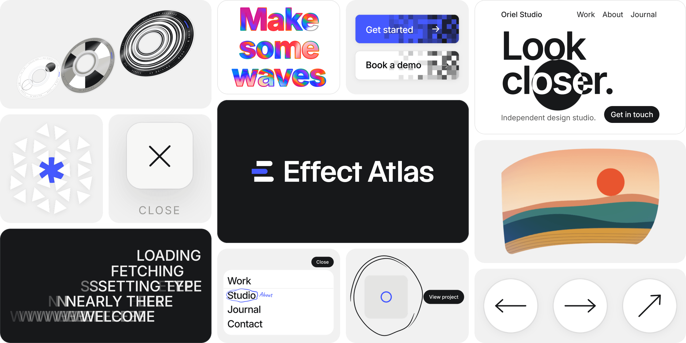

# Effect Atlas

43 web motion effects in plain JavaScript, written for your AI to build into your site.

[effectatlas.com](https://effectatlas.com) · [中文](https://effectatlas.com/zh/)

## What's in a folder

```
effects/<slug>/
  effect.js     the effect; the comment at the top is written for your AI
  effect.css    its styles
  index.html    a working demo
```

Curved Gallery, Disc Carousel and Hold to Burst also have `three.min.js` (three.js r128) and its license, `three.LICENSE.txt`. Nothing else to install.

## Use an effect

**See it.** Double-click `index.html`. It runs from disk: no server, no build step, nothing loaded from the network.

**Hand it to your AI.** Give it the folder and say where the effect should go. The comment at the top of every `effect.js` is written for the AI: what the effect does, how it moves, and its options. Most also cover the API, what is safe to change, what not to touch, and how to port it to React, Vue, Svelte or Webflow.

```text
Add the effect in effects/fluid-mask-hero/ to the hero section of my site.
Read the comment at the top of effect.js first and follow it.
Keep the copyright comment at the top of the code.
```

**Or wire it up yourself.** Do what `index.html` does: link `effect.css`, load `effect.js`, then call the mount function on an element that has a size.

```html
<link rel="stylesheet" href="effect.css">
<div id="stage" style="height: 560px"></div>
<script src="effect.js"></script>
<script>
  const fx = mountOrbitCursor(document.getElementById('stage'));
</script>
```

Each effect has its own mount function, named in its `index.html` and in the comment at the top of `effect.js`. For the three.js effects, load `three.min.js` before `effect.js`.

## Effects

The same eight groups as the site, then Other for the one effect that is in none of them. Each effect is listed once, under its main group; on the site, some also show up in one or two more groups. Names open the live demo.

### Cursor

Cursor effects that follow the pointer.

| Effect | What it does | Folder |
| --- | --- | --- |
| [Orbit Cursor](https://effectatlas.com/effects/orbit-cursor) | A dial whose dot follows your cursor around the ring. | [`effects/orbit-cursor/`](effects/orbit-cursor/) |
| [Magnetic Symbol Field](https://effectatlas.com/effects/magnetic-symbol-field) | A grid of symbols that scatters away from your cursor. | [`effects/magnetic-symbol-field/`](effects/magnetic-symbol-field/) |
| [Torn Cursor Ink](https://effectatlas.com/effects/torn-cursor-ink) | A cursor that tears ragged holes through the page. | [`effects/torn-cursor-ink/`](effects/torn-cursor-ink/) |

### Hover

Hover effects for buttons, links and cards.

| Effect | What it does | Folder |
| --- | --- | --- |
| [Film Jitter Button](https://effectatlas.com/effects/film-jitter-hover) | A button that shakes like old film on hover. | [`effects/film-jitter-hover/`](effects/film-jitter-hover/) |
| [Stacked Frame Index](https://effectatlas.com/effects/stacked-frame-index) | An index whose thumbnails flip through frames on hover. | [`effects/stacked-frame-index/`](effects/stacked-frame-index/) |
| [Scribble Ring](https://effectatlas.com/effects/scribble-ring) | A hand-drawn ring that circles whatever you hover. | [`effects/scribble-ring/`](effects/scribble-ring/) |
| [Fractured Word Hover](https://effectatlas.com/effects/fractured-word-hover) | Links that crack along a jagged line when you point at them. | [`effects/fractured-word-hover/`](effects/fractured-word-hover/) |
| [Redrawn Arrow](https://effectatlas.com/effects/redrawn-arrow-hover) | Hover an arrow: the old one slides off and erases, a new one draws itself in. | [`effects/redrawn-arrow-hover/`](effects/redrawn-arrow-hover/) |
| [Link Hover Set](https://effectatlas.com/effects/link-hover-set) | Two link hovers for real pages: a double underline that chases itself, and letters that roll with an arrow that swaps out. Hover any link. | [`effects/link-hover-set/`](effects/link-hover-set/) |
| [Tear-Off Pricing Ticket](https://effectatlas.com/effects/tear-off-pricing-ticket) | Scroll to bring the price tickets up and flip them over, then hover one to tear off its stub. | [`effects/tear-off-pricing-ticket/`](effects/tear-off-pricing-ticket/) |
| [Pixel Wipe Button](https://effectatlas.com/effects/pixel-wipe-button) | A button hover that fills in square by square, frame by frame. On the way out it never rewinds: the old colour sweeps back in from the left. Hover any button. | [`effects/pixel-wipe-button/`](effects/pixel-wipe-button/) |

### Text

Text effects that move the letters.

| Effect | What it does | Folder |
| --- | --- | --- |
| [Scroll Speed Scramble](https://effectatlas.com/effects/scroll-speed-scramble) | A headline that scrambles into letters the faster you scroll. | [`effects/scroll-speed-scramble/`](effects/scroll-speed-scramble/) |
| [Masked Word Flip](https://effectatlas.com/effects/masked-word-flip) | Word pairs that flip up through narrow masks. | [`effects/masked-word-flip/`](effects/masked-word-flip/) |
| [Mask Decode Reveal](https://effectatlas.com/effects/mask-decode-reveal) | Ink bars sweep across headlines while labels decode. | [`effects/mask-decode-reveal/`](effects/mask-decode-reveal/) |
| [Prismatic Fluid Headline](https://effectatlas.com/effects/prismatic-fluid-headline) | Sweep across an outlined headline and liquid colour swirls inside the letters, then fades. | [`effects/prismatic-fluid-headline/`](effects/prismatic-fluid-headline/) |

### Menus

Menus that open, slide and point the way.

| Effect | What it does | Folder |
| --- | --- | --- |
| [Dock Menu Dropdown](https://effectatlas.com/effects/dock-menu-dropdown) | A compact nav that grows into a scrollable index. | [`effects/dock-menu-dropdown/`](effects/dock-menu-dropdown/) |
| [Curtain Menu](https://effectatlas.com/effects/curtain-menu) | A fullscreen menu with large type and live previews. | [`effects/curtain-menu/`](effects/curtain-menu/) |
| [Hairline Burger](https://effectatlas.com/effects/hairline-burger) | A two-line menu button that folds into a cross. | [`effects/hairline-burger/`](effects/hairline-burger/) |
| [Local Clock Pill](https://effectatlas.com/effects/local-clock-pill) | A local-time pill that rolls over to a contact link. | [`effects/local-clock-pill/`](effects/local-clock-pill/) |
| [Annotated Menu](https://effectatlas.com/effects/annotated-menu) | Hover a menu item and it gets struck through and rewritten by hand, like a marked-up proof. | [`effects/annotated-menu/`](effects/annotated-menu/) |
| [Scroll Minimap](https://effectatlas.com/effects/scroll-minimap) | A little map of the whole page, with a frame showing where you are. Scroll, or click a block to jump. | [`effects/scroll-minimap/`](effects/scroll-minimap/) |

### Scroll

Effects driven by the scroll.

| Effect | What it does | Folder |
| --- | --- | --- |
| [Scroll Card Stack](https://effectatlas.com/effects/scroll-card-stack) | Cards that slide up and stack as you scroll. | [`effects/scroll-card-stack/`](effects/scroll-card-stack/) |
| [Crosshair Image Reveal](https://effectatlas.com/effects/crosshair-image-reveal) | An image that unfolds from a draggable crosshair. | [`effects/crosshair-image-reveal/`](effects/crosshair-image-reveal/) |
| [Fullscreen Chapter Reveal](https://effectatlas.com/effects/fullscreen-chapter-reveal) | Fullscreen scenes that crop open over one another. | [`effects/fullscreen-chapter-reveal/`](effects/fullscreen-chapter-reveal/) |
| [Noise Dissolve Reveal](https://effectatlas.com/effects/noise-dissolve-reveal) | A living, noisy edge that dissolves one layer into another. | [`effects/noise-dissolve-reveal/`](effects/noise-dissolve-reveal/) |
| [Smear-In Grid](https://effectatlas.com/effects/smear-in-grid) | Images that stretch in from blurred bands, out of order. | [`effects/smear-in-grid/`](effects/smear-in-grid/) |
| [Scroll Card Deal](https://effectatlas.com/effects/scroll-card-deal) | A face-down pile that deals out into a row and flips card by card as you scroll. | [`effects/scroll-card-deal/`](effects/scroll-card-deal/) |
| [Scroll Warp Zoom](https://effectatlas.com/effects/scroll-warp-zoom) | Scroll and the small card swells from its centre into a big one, colour flooding back in. | [`effects/scroll-warp-zoom/`](effects/scroll-warp-zoom/) |

### Hero

Openers for the top of the page.

| Effect | What it does | Folder |
| --- | --- | --- |
| [Fluid Mask Hero](https://effectatlas.com/effects/fluid-mask-hero) | A soft circular lens that reveals an inverted hero beneath. | [`effects/fluid-mask-hero/`](effects/fluid-mask-hero/) |
| [Poster Masthead Collapse](https://effectatlas.com/effects/poster-masthead-collapse) | A hairline unfolds into a poster, then folds into a logo. | [`effects/poster-masthead-collapse/`](effects/poster-masthead-collapse/) |
| [Card Fan Intro](https://effectatlas.com/effects/card-fan-intro) | Cards fan out, fold away, and hand over to the hero. | [`effects/card-fan-intro/`](effects/card-fan-intro/) |

### Transitions

Transitions from one view to the next.

| Effect | What it does | Folder |
| --- | --- | --- |
| [Line-by-Line Handoff](https://effectatlas.com/effects/line-by-line-handoff) | Pages that swap line by line while the logo stays. | [`effects/line-by-line-handoff/`](effects/line-by-line-handoff/) |
| [Shared Element Transition](https://effectatlas.com/effects/shared-element-transition) | A thumbnail that grows into a full detail view and back. | [`effects/shared-element-transition/`](effects/shared-element-transition/) |
| [Torn Sheet Transition](https://effectatlas.com/effects/torn-sheet-transition) | A torn ink sheet that covers and reveals each page. | [`effects/torn-sheet-transition/`](effects/torn-sheet-transition/) |
| [Cut-Line Preloader](https://effectatlas.com/effects/cut-line-preloader) | A counter rolls to 100 while scissors cut the page open. | [`effects/cut-line-preloader/`](effects/cut-line-preloader/) |
| [Smear-Trail Preloader](https://effectatlas.com/effects/smear-trail-preloader) | Lines of text whip in dragging a trail of their own letters, then the cover lifts. | [`effects/smear-trail-preloader/`](effects/smear-trail-preloader/) |
| [Crop-Line Page Transition](https://effectatlas.com/effects/crop-line-page-transition) | Four lines close the page to a cross, then keep going and open the next one. | [`effects/crop-line-page-transition/`](effects/crop-line-page-transition/) |

### Galleries

Galleries for images and cards.

| Effect | What it does | Folder |
| --- | --- | --- |
| [Inertia Drag](https://effectatlas.com/effects/inertia-drag) | Tiles you can toss that glide, tilt, and settle. | [`effects/inertia-drag/`](effects/inertia-drag/) |
| [Horizontal Wheel Strip](https://effectatlas.com/effects/horizontal-wheel-strip) | A horizontal strip that glides with inertia. | [`effects/horizontal-wheel-strip/`](effects/horizontal-wheel-strip/) |
| [Curved Gallery](https://effectatlas.com/effects/curved-gallery) | A drag-to-spin gallery curved like a wall. | [`effects/curved-gallery/`](effects/curved-gallery/) |
| [Hanging Card Carousel](https://effectatlas.com/effects/hanging-card-carousel) | A row of hanging cards that swing when flung. | [`effects/hanging-card-carousel/`](effects/hanging-card-carousel/) |
| [Disc Carousel](https://effectatlas.com/effects/disc-carousel) | A tilted row of discs that turns one at a time. | [`effects/disc-carousel/`](effects/disc-carousel/) |

### Other

Not in any of the groups above.

| Effect | What it does | Folder |
| --- | --- | --- |
| [Hold to Burst](https://effectatlas.com/effects/hold-to-burst) | Hold to charge a shape until it bursts apart. | [`effects/hold-to-burst/`](effects/hold-to-burst/) |

## License

Source-available under the [Effect Atlas License 1.0](LICENSE), adapted from the MIT License and the Commons Clause. It is not the MIT License.

Every effect is free to use, in your own projects and in client work, and you're welcome to share them. What you can't do is sell them on their own.

- Keep the copyright comment at the top of the code. Credit to Effect Atlas is appreciated but not required.
- Don't mirror effectatlas.com or this repository, in whole or in substantial part. Forking it on GitHub is fine. Publishing a fork as a website or a package counts as mirroring.
- The code is provided as is, with no warranty.
- three.js stays under its own MIT License, in `three.LICENSE.txt` next to it. Annotated Menu embeds a subset of the Caveat font (SIL Open Font License 1.1, Copyright 2014 The Caveat Project Authors), license in `effects/annotated-menu/Caveat.LICENSE.txt`.

Full text: [LICENSE](LICENSE) or [effectatlas.com/license](https://effectatlas.com/license).

## Contact

[hello@effectatlas.com](mailto:hello@effectatlas.com)

Copyright (c) 2026 PROJECT Y/O
