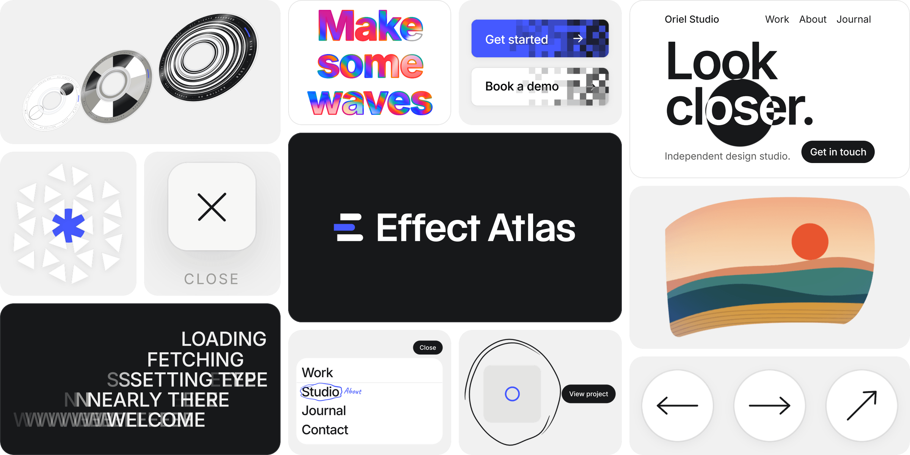

[English](README.md) | 简体中文



# Effect Atlas

43 个前端动效，原生 JavaScript 编写，写给你的 AI，让它搭进你的网站。

[effectatlas.com](https://effectatlas.com/zh/) · [English](https://effectatlas.com)

## 每个文件夹里有什么

```
effects/<slug>/
  effect.js     效果本身；开头的注释是写给你的 AI 看的
  effect.css    它的样式
  index.html    可以直接运行的演示
```

弧面画廊、圆盘轮播和长按迸发还带有 `three.min.js`（three.js r128）和它的许可证 `three.LICENSE.txt`。除此之外，不用安装任何东西。

## 使用效果

**先看看。** 双击 `index.html`。它直接从本地文件运行：不需要服务器，不需要构建，也不从网络加载任何东西。

**交给你的 AI。** 把文件夹给它，告诉它效果要放在哪里。每个 `effect.js` 开头的注释都是写给 AI 看的：这个效果做什么、怎么动、有哪些选项。大多数还写了 API、哪些可以放心改、哪些不要动，以及怎么移植到 React、Vue、Svelte 或 Webflow。

```text
把 effects/fluid-mask-hero/ 里的效果加到我网站的首屏。
先读 effect.js 开头的注释，照着做。
保留代码开头的版权注释。
```

**或者自己接入。** 照 `index.html` 的做法：引入 `effect.css`，加载 `effect.js`，再在一个有尺寸的元素上调用挂载函数。

```html
<link rel="stylesheet" href="effect.css">
<div id="stage" style="height: 560px"></div>
<script src="effect.js"></script>
<script>
  const fx = mountOrbitCursor(document.getElementById('stage'));
</script>
```

每个效果都有自己的挂载函数，函数名写在它的 `index.html` 里，也写在 `effect.js` 开头的注释里。用到 three.js 的效果，要先加载 `three.min.js`，再加载 `effect.js`。

## 效果

前八个分类和网站一样，最后的“其他”放的是不在任何分类里的那一个效果。每个效果只列一次，放在它的主分类下；在网站上，有些效果还会出现在另外一两个分类里。点效果名可以打开在线演示。

### 光标

跟着指针走的光标效果。

| 效果 | 介绍 | 文件夹 |
| --- | --- | --- |
| [环绕光标](https://effectatlas.com/zh/effects/orbit-cursor) | 一个表盘，上面的圆点会沿着圆环跟着光标转。 | [`effects/orbit-cursor/`](effects/orbit-cursor/) |
| [磁力符号阵](https://effectatlas.com/zh/effects/magnetic-symbol-field) | 排成网格的一片符号，光标靠近就被推开。 | [`effects/magnetic-symbol-field/`](effects/magnetic-symbol-field/) |
| [撕裂光标](https://effectatlas.com/zh/effects/torn-cursor-ink) | 光标划过的地方，页面被撕出一个个毛边破洞。 | [`effects/torn-cursor-ink/`](effects/torn-cursor-ink/) |

### 悬停

用在按钮、链接和卡片上的悬停效果。

| 效果 | 介绍 | 文件夹 |
| --- | --- | --- |
| [胶片抖动按钮](https://effectatlas.com/zh/effects/film-jitter-hover) | 鼠标放上去，按钮会像老胶片那样抖起来。 | [`effects/film-jitter-hover/`](effects/film-jitter-hover/) |
| [叠帧索引](https://effectatlas.com/zh/effects/stacked-frame-index) | 一份索引列表，悬停时缩略图会一帧帧翻过去。 | [`effects/stacked-frame-index/`](effects/stacked-frame-index/) |
| [手绘圈](https://effectatlas.com/zh/effects/scribble-ring) | 悬停到哪儿，就有一圈手绘线把它圈起来。 | [`effects/scribble-ring/`](effects/scribble-ring/) |
| [裂字悬停](https://effectatlas.com/zh/effects/fractured-word-hover) | 指向链接时，文字会沿一道锯齿线裂开。 | [`effects/fractured-word-hover/`](effects/fractured-word-hover/) |
| [重画箭头](https://effectatlas.com/zh/effects/redrawn-arrow-hover) | 悬停在箭头上：旧箭头滑走、擦掉，新箭头自己画出来。 | [`effects/redrawn-arrow-hover/`](effects/redrawn-arrow-hover/) |
| [链接悬停合集](https://effectatlas.com/zh/effects/link-hover-set) | 两种能直接用在页面上的链接悬停：一种是两条下划线前后追着跑，一种是字母滚动、箭头换一个新的。随便悬停一个链接试试。 | [`effects/link-hover-set/`](effects/link-hover-set/) |
| [撕票卡片](https://effectatlas.com/zh/effects/tear-off-pricing-ticket) | 滚动让价格票升上来、翻到正面，再悬停在一张上，把票根撕下来。 | [`effects/tear-off-pricing-ticket/`](effects/tear-off-pricing-ticket/) |
| [像素擦除按钮](https://effectatlas.com/zh/effects/pixel-wipe-button) | 悬停时按钮一格一格、一帧一帧地填满。移开时不倒放，而是原来的颜色从左边重新扫回来。随便悬停一个按钮试试。 | [`effects/pixel-wipe-button/`](effects/pixel-wipe-button/) |

### 文字

让文字动起来的效果。

| 效果 | 介绍 | 文件夹 |
| --- | --- | --- |
| [滚速乱码](https://effectatlas.com/zh/effects/scroll-speed-scramble) | 一行标题，滚得越快，字母乱得越厉害。 | [`effects/scroll-speed-scramble/`](effects/scroll-speed-scramble/) |
| [遮罩翻词](https://effectatlas.com/zh/effects/masked-word-flip) | 一组组词透过窄窄的遮罩往上翻。 | [`effects/masked-word-flip/`](effects/masked-word-flip/) |
| [遮罩乱码](https://effectatlas.com/zh/effects/mask-decode-reveal) | 墨色色条扫过标题，旁边的标签同时从乱码里解出来。 | [`effects/mask-decode-reveal/`](effects/mask-decode-reveal/) |
| [彩色流体遮罩](https://effectatlas.com/zh/effects/prismatic-fluid-headline) | 在空心大标题上划过，字母里会卷起流动的彩色，然后慢慢褪掉。 | [`effects/prismatic-fluid-headline/`](effects/prismatic-fluid-headline/) |

### 菜单

会展开、会动的菜单。

| 效果 | 介绍 | 文件夹 |
| --- | --- | --- |
| [停靠下拉菜单](https://effectatlas.com/zh/effects/dock-menu-dropdown) | 一条小导航，展开后变成可以滚动的目录。 | [`effects/dock-menu-dropdown/`](effects/dock-menu-dropdown/) |
| [幕布菜单](https://effectatlas.com/zh/effects/curtain-menu) | 全屏菜单，大字，带实时预览。 | [`effects/curtain-menu/`](effects/curtain-menu/) |
| [细线菜单按钮](https://effectatlas.com/zh/effects/hairline-burger) | 两条线组成的菜单按钮，会折成一个叉。 | [`effects/hairline-burger/`](effects/hairline-burger/) |
| [本地时钟胶囊](https://effectatlas.com/zh/effects/local-clock-pill) | 显示本地时间的胶囊，悬停时翻成联系链接。 | [`effects/local-clock-pill/`](effects/local-clock-pill/) |
| [批注菜单](https://effectatlas.com/zh/effects/annotated-menu) | 悬停在菜单项上，它会被划掉、再手写改一遍，像改过的校样。 | [`effects/annotated-menu/`](effects/annotated-menu/) |
| [滚动小地图](https://effectatlas.com/zh/effects/scroll-minimap) | 整个页面的小地图，用一个框标出你现在看到哪儿。滚动，或者点一块直接跳过去。 | [`effects/scroll-minimap/`](effects/scroll-minimap/) |

### 滚动

随滚动变化的效果。

| 效果 | 介绍 | 文件夹 |
| --- | --- | --- |
| [滚动卡片堆叠](https://effectatlas.com/zh/effects/scroll-card-stack) | 随着滚动，卡片往上滑，一张张叠起来。 | [`effects/scroll-card-stack/`](effects/scroll-card-stack/) |
| [十字线揭图](https://effectatlas.com/zh/effects/crosshair-image-reveal) | 图片从一个可以拖动的十字线处展开。 | [`effects/crosshair-image-reveal/`](effects/crosshair-image-reveal/) |
| [全屏章节揭开](https://effectatlas.com/zh/effects/fullscreen-chapter-reveal) | 一屏屏全屏画面，一个接一个裁开，盖在前一个上面。 | [`effects/fullscreen-chapter-reveal/`](effects/fullscreen-chapter-reveal/) |
| [噪声溶解揭开](https://effectatlas.com/zh/effects/noise-dissolve-reveal) | 一条一直在动的噪声边缘，把一层画面溶成另一层。 | [`effects/noise-dissolve-reveal/`](effects/noise-dissolve-reveal/) |
| [模糊横带入场](https://effectatlas.com/zh/effects/smear-in-grid) | 图片从模糊的横带里撑开入场，顺序是打乱的。 | [`effects/smear-in-grid/`](effects/smear-in-grid/) |
| [滚动发牌](https://effectatlas.com/zh/effects/scroll-card-deal) | 一叠扣着的牌，随滚动发成一排，再一张张翻过来。 | [`effects/scroll-card-deal/`](effects/scroll-card-deal/) |
| [滚动扭曲放大](https://effectatlas.com/zh/effects/scroll-warp-zoom) | 一滚动，小卡片从中间撑起、放大成大卡片，颜色也跟着回来。 | [`effects/scroll-warp-zoom/`](effects/scroll-warp-zoom/) |

### 首屏

放在页面最上面的开场效果。

| 效果 | 介绍 | 文件夹 |
| --- | --- | --- |
| [遮罩首屏](https://effectatlas.com/zh/effects/fluid-mask-hero) | 一个边缘柔和的圆形镜头，透出下面一层反色的首屏。 | [`effects/fluid-mask-hero/`](effects/fluid-mask-hero/) |
| [海报刊头收拢](https://effectatlas.com/zh/effects/poster-masthead-collapse) | 一根细线展开成海报，再收成一个 logo。 | [`effects/poster-masthead-collapse/`](effects/poster-masthead-collapse/) |
| [扇形卡片开场](https://effectatlas.com/zh/effects/card-fan-intro) | 卡片扇形散开、再收起来，然后交给首屏。 | [`effects/card-fan-intro/`](effects/card-fan-intro/) |

### 转场

从上一页到下一页的转场。

| 效果 | 介绍 | 文件夹 |
| --- | --- | --- |
| [逐行过渡入场](https://effectatlas.com/zh/effects/line-by-line-handoff) | logo 不动，页面一行一行地换。 | [`effects/line-by-line-handoff/`](effects/line-by-line-handoff/) |
| [共享元素转场](https://effectatlas.com/zh/effects/shared-element-transition) | 缩略图放大成完整的详情页，也能再缩回去。 | [`effects/shared-element-transition/`](effects/shared-element-transition/) |
| [撕纸转场](https://effectatlas.com/zh/effects/torn-sheet-transition) | 一张撕边的墨色纸，把每一页盖上再揭开。 | [`effects/torn-sheet-transition/`](effects/torn-sheet-transition/) |
| [剪线入场](https://effectatlas.com/zh/effects/cut-line-preloader) | 数字滚到 100，同时一把剪刀把页面剪开。 | [`effects/cut-line-preloader/`](effects/cut-line-preloader/) |
| [拖影入场](https://effectatlas.com/zh/effects/smear-trail-preloader) | 一行行文字甩进来，身后拖着自己字母的残影，最后盖板掀起来。 | [`effects/smear-trail-preloader/`](effects/smear-trail-preloader/) |
| [裁切线转场](https://effectatlas.com/zh/effects/crop-line-page-transition) | 四条线把页面收成一个十字，接着继续走，打开下一页。 | [`effects/crop-line-page-transition/`](effects/crop-line-page-transition/) |

### 画廊

用来展示的画廊。

| 效果 | 介绍 | 文件夹 |
| --- | --- | --- |
| [惯性拖拽](https://effectatlas.com/zh/effects/inertia-drag) | 可以甩出去的方块，会滑行、倾斜，然后停稳。 | [`effects/inertia-drag/`](effects/inertia-drag/) |
| [横向滚轮长条](https://effectatlas.com/zh/effects/horizontal-wheel-strip) | 一条横向长条，滑动时带着惯性。 | [`effects/horizontal-wheel-strip/`](effects/horizontal-wheel-strip/) |
| [弧面画廊](https://effectatlas.com/zh/effects/curved-gallery) | 弯成一面弧墙的画廊，拖一下就转起来。 | [`effects/curved-gallery/`](effects/curved-gallery/) |
| [悬挂卡片轮播](https://effectatlas.com/zh/effects/hanging-card-carousel) | 一排挂着的卡片，甩一下就晃起来。 | [`effects/hanging-card-carousel/`](effects/hanging-card-carousel/) |
| [圆盘轮播](https://effectatlas.com/zh/effects/disc-carousel) | 一排斜放的圆盘，一次转过一张。 | [`effects/disc-carousel/`](effects/disc-carousel/) |

### 其他

不属于上面任何一个分类。

| 效果 | 介绍 | 文件夹 |
| --- | --- | --- |
| [长按迸发](https://effectatlas.com/zh/effects/hold-to-burst) | 按住给图形蓄力，直到它炸开。 | [`effects/hold-to-burst/`](effects/hold-to-burst/) |

## 许可协议

源码公开，采用 [Effect Atlas License 1.0](LICENSE) 发布，基于 MIT 许可证和 Commons Clause 改写。它不是 MIT 许可证。

每个效果都可以免费使用，用在你自己的项目里、用在客户项目里都可以，也欢迎分享。不能做的是单独售卖。

- 保留代码开头的版权注释。欢迎注明出自 Effect Atlas，但不是必须的。
- 不得整体或大部分复制 effectatlas.com 或本仓库。在 GitHub 上 fork 本仓库没有问题；把 fork 发布成网站或软件包，就算作复制。
- 代码按原样提供，不提供担保。
- three.js 仍沿用它自己的 MIT 许可证，见旁边的 `three.LICENSE.txt`。批注菜单内嵌了 Caveat 字体的一个子集（SIL Open Font License 1.1，Copyright 2014 The Caveat Project Authors），许可证见 `effects/annotated-menu/Caveat.LICENSE.txt`。

完整协议：[LICENSE](LICENSE)，或 [effectatlas.com/zh/license](https://effectatlas.com/zh/license)。协议保留英文原文，不作翻译；本节中文仅为方便阅读，以英文版为准。

## 联系方式

[hello@effectatlas.com](mailto:hello@effectatlas.com)

Copyright (c) 2026 PROJECT Y/O

## 友情链接

- [LINUX DO](https://linux.do)：感谢社区对我在 AI 学习上的帮助。
